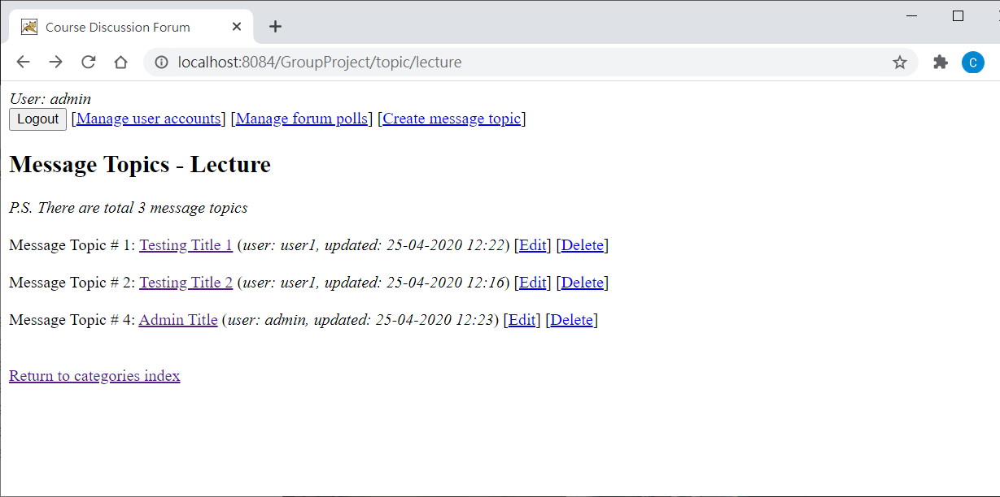

# COMPS380F-Assignment
> **OUHK 2019/20 Web Applications Design and Development (COMPS380F) Assignment**
>
> A full-featured enterprise web application built with **Spring MVC** and **Spring Security**, providing a structured platform for academic discussions, resource sharing, and polling.

[](#) &nbsp;
[](#) &nbsp;
[](#) &nbsp;
[](LICENSE) &nbsp;

## Project Overview
This forum system is designed to handle academic interactions through a hierarchical structure. It utilizes **Spring MVC** for request handling and **Spring Security** for robust authentication and Role-Based Access Control (RBAC).

### Core Architecture:
* **Controller Layer:** Managed by Spring MVC for dynamic page generation.
* **Security Layer:** Implements Spring Security to safeguard file downloads and administrative actions.
* **Data Layer:** Persistent storage using Apache Derby SQL database for users, threads, and binary file attachments.

## Role-Based Access Control (RBAC)
| Feature | Guest | Registered User | Administrator |
| :--- | :---: | :---: | :---: |
| View Threads & Poll Results | ✅ | ✅ | ✅ |
| Create Threads & Replies | ❌ | ✅ | ✅ |
| Vote in Polls | ❌ | ✅ | ✅ |
| Download Attachments | ❌ | ✅ | ✅ |
| Batch Upload Files | ❌ | ✅ | ✅ |
| Delete Threads/Replies | ❌ | ❌ | ✅ |
| Manage User Accounts | ❌ | ❌ | ✅ |
| Create New Polls | ❌ | ❌ | ✅ |

## Advanced Features
* **Hierarchical Organization:** Content categorized into *Lecture*, *Lab*, and *Other* with real-time thread/reply counters.
* **Poll System:** Interactive Multiple-Choice polling with historical result tracking.
* **Blob Management:** Storing file attachments directly within the relational database as BLOBs.
* **Batch Operations:** Efficient batch uploading for multiple file attachments in a single post.

## Installation & Setup
### 1. Database Configuration
Create a JDBC Derby database with the following credentials:
* **Database Name:** `GroupProject`
* **Username:** `nbuser`
* **Password:** `nbuser`

### 2. Initialize Data
Import the 3 SQL files located in `src/resources` to initialize the schema and default accounts.

### 3. Default Accounts
| Role | Username | Password |
| :--- | :--- | :--- |
| **Admin** | `admin` | `admin` |
| **Admin** | `keith` | `keithpw` |
| **Admin** | `vanessa` | `vanessapw` |
| **User** | `user1` | `user1` |
| **User** | `user2` | `user2` |
| **User** | `kevin` | `kevinpw` |
| **User** | `oliver` | `oliverpw` |

## Screenshots


## License
- COMPS380F-Assignment is released under the [MIT License](https://opensource.org/licenses/MIT).
```
Copyright (c) 2020 alvinau0427

Permission is hereby granted, free of charge, to any person obtaining a copy
of this software and associated documentation files (the "Software"), to deal
in the Software without restriction, including without limitation the rights
to use, copy, modify, merge, publish, distribute, sublicense, and/or sell
copies of the Software, and to permit persons to whom the Software is
furnished to do so, subject to the following conditions:

The above copyright notice and this permission notice shall be included in all
copies or substantial portions of the Software.

THE SOFTWARE IS PROVIDED "AS IS", WITHOUT WARRANTY OF ANY KIND, EXPRESS OR
IMPLIED, INCLUDING BUT NOT LIMITED TO THE WARRANTIES OF MERCHANTABILITY,
FITNESS FOR A PARTICULAR PURPOSE AND NONINFRINGEMENT. IN NO EVENT SHALL THE
AUTHORS OR COPYRIGHT HOLDERS BE LIABLE FOR ANY CLAIM, DAMAGES OR OTHER
LIABILITY, WHETHER IN AN ACTION OF CONTRACT, TORT OR OTHERWISE, ARISING FROM,
OUT OF OR IN CONNECTION WITH THE SOFTWARE OR THE USE OR OTHER DEALINGS IN THE
SOFTWARE.
```
